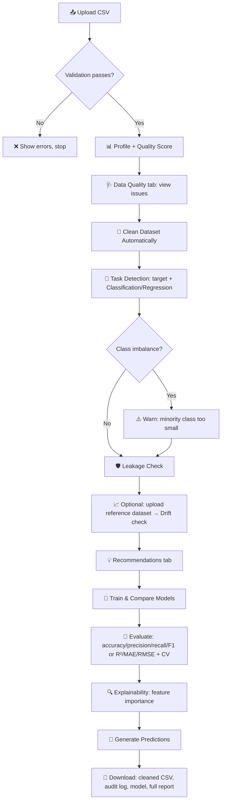

<h1 align="center">🧭 DataPilot</h1>
<p align="center"><b>Upload a CSV. Get a cleaned dataset, a trained model, and a full report — with proof of exactly what it did and why.</b></p>

<p align="center">
  <a href="https://www.python.org/"></a>
  <a href="https://streamlit.io/"></a>
  <a href="https://pandas.pydata.org/"></a>
  <a href="https://scikit-learn.org/"></a>
  <a href="https://numpy.org/"></a>
  <a href="https://docs.pytest.org/"></a>
  <a href="https://www.docker.com/"></a>
  <a href="LICENSE"></a>
</p>

<p align="center">
  <i>Upload a CSV. DataPilot validates it, profiles it, scores and cleans its quality issues, detects the right ML task, checks for target leakage, trains and compares models, explains predictions, monitors drift, and builds a downloadable report — all without writing a line of code.</i>
</p>

<!--
📸 IMAGE PLACEHOLDER
Insert: A screenshot of the main dashboard right after a CSV is uploaded —
        the sidebar (dataset name, row/col count) plus the Overview tab
        showing the metric cards (Rows, Columns, Duplicate Rows, Missing Values).
Where: Right here, directly under the badges.
Purpose: First thing a recruiter or visitor sees — should communicate
         "this is a real, working tool" in under two seconds.
-->

---

## 📑 Table of Contents

- [What is DataPilot?](#-what-is-datapilot)
- [Problem Statement](#-problem-statement)
- [Solution](#-solution)
- [Features](#-features)
- [Complete Workflow](#-complete-workflow)
- [Architecture](#️-architecture)
- [Project Structure](#-project-structure)
- [Module-by-Module Guide](#-module-by-module-guide)
- [Technology Stack](#️-technology-stack)
- [Requirements](#️-requirements)
- [Installation](#-installation)
- [Running the App](#️-running-the-app)
- [Beginner Usage Guide](#-beginner-usage-guide)
- [Input & Output](#-input--output)
- [Algorithms, Heuristics & Formulas](#-algorithms-heuristics--formulas)
- [Testing](#-testing)
- [Real Bugs Found & Fixed](#-real-bugs-found--fixed)
- [Engineering Decisions](#-engineering-decisions)
- [Hardcoding & Generalization](#-hardcoding--generalization)
- [Technical Deep Dive](#-technical-deep-dive)
- [Edge Cases](#-edge-cases)
- [Known Limitations](#️-known-limitations)
- [Roadmap](#-roadmap)
- [Scalability](#-scalability)
- [Docker & Deployment](#-docker--deployment)
- [Security & Privacy](#-security--privacy)
- [Performance](#-performance)
- [External Resources](#-external-resources)
- [Contributing](#-contributing)
- [License](#-license)
- [Author](#-author)
- [Why This Project Matters](#-why-this-project-matters)
- [Interview Prep: Likely Questions](#-interview-prep-likely-questions)
- [Final Summary](#-final-summary)

---

## 📖 What is DataPilot?

**In plain English:** you have a spreadsheet of data (a CSV file) and you want to know if it's any good, clean it up, and maybe build a prediction model from it — but you don't want to write pandas/scikit-learn code every single time. DataPilot is a web page where you drag in a CSV and it does that whole pipeline for you, showing its work at every step.

**For a complete beginner:** imagine you have customer data and want to predict who might cancel their subscription. Normally that means opening a code editor, writing cleaning code, writing training code, writing evaluation code — hours of setup before you learn anything. DataPilot does that first pass for you: upload the file, click through a few tabs, and get a trained model, an explanation of what it learned, and a downloadable report.

**Technically:** DataPilot is a single-page [Streamlit](https://streamlit.io/) application backed by a pure-Python, UI-agnostic engine (`src/`). Nothing in `src/` imports Streamlit — every function takes a `pandas.DataFrame` in and returns a dict, list, or DataFrame out, which is what makes the entire pipeline independently unit-testable without a browser.

Who it's for: students/self-taught developers doing first-pass EDA, anyone who wants a quick "is this dataset trainable, and on what?" answer, and — per the author's own use — a portfolio project demonstrating a real, tested, multi-stage pipeline rather than a single notebook.

---

## 🎯 Problem Statement

**Beginner version:** every new CSV file means the same boring checklist by hand — missing values? duplicates? weird outliers? what should I even predict? which model is best? That's tedious and easy to get wrong.

**Technical version:** the first-pass stages of a tabular ML workflow — schema validation, EDA, cleaning, task/target inference, leakage screening, baseline model comparison, and reporting — are largely mechanical and repeat almost identically across datasets, yet are usually re-implemented ad hoc in a notebook every time. DataPilot codifies that repeatable part as a tested, reusable pipeline, while explicitly leaving domain judgment (is this outlier real? is this the right target?) to the human — surfaced through explainable, overridable decisions rather than a black box.

---

## 💡 Solution

```text
Raw CSV
   ↓
Validation           (is this dataset usable at all?)
   ↓
Profiling + Quality scoring   (what does it look like, what's wrong?)
   ↓
Automated cleaning   (optional, with a full audit log)
   ↓
Target/task detection   (what should we predict, and how?)
   ↓
Leakage check        (would any feature "cheat"?)
   ↓
Train & compare multiple models   (with cross-validation)
   ↓
Explain the winner   (feature importance)
   ↓
Predict + Monitor drift + Recommend next steps
   ↓
Downloadable report, cleaned CSV, model file
```

The guiding rule visible throughout the codebase: **auto-fix things with one universally safe answer** (a missing number → median; extra whitespace → trimmed), and **surface, warn, but never silently guess** things that require judgment (is this outlier real? is this imbalance a problem? does this look like PII?). Every arrow above is a real, separate, independently-tested module in `src/` — not a single monolithic script.

---

## ✨ Features

### ✅ Implemented

| Feature | What it does |
|---|---|
| **Validation** | Structural checks before anything else runs — empty dataset, no columns, duplicate column names, columns ≥50% missing. `src/validator.py` |
| **Profiling** | Per-column dtype, missing count/%, uniqueness, constant-column flag; dataset-level totals. `src/profiler.py` |
| **Quality scoring (0–100)** | Nine independent issue detectors, rolled into one score weighted by *proportion of rows affected*, not a flat penalty per issue type. `src/quality.py` |
| **Automated cleaning** | Duplicate removal, median/mode imputation, categorical text normalization, IQR-based outlier correction with an identifier-column guard — every change logged with category, column, action, count, and plain-English reason. `src/cleaner.py` |
| **ML task detection** | Multi-signal heuristic guesses the likely target column and whether it's Classification or Regression. The user always gets a final, editable dropdown — auto-detection is a default, not a decision. `src/task_detector.py` |
| **Class imbalance check** | Flags a minority class under 10% of rows, with a harder flag under 2 examples (too few to even split into train/test). `src/task_detector.py` |
| **Target leakage detection** | Flags suspicious feature names, exact duplicate columns of the target, and correlations ≥0.98 — protected against `inf`/extreme-magnitude values and zero-variance columns. `src/leakage.py` |
| **Model training & comparison** | Logistic Regression / Decision Tree / Random Forest (classification, all `class_weight="balanced"`), or Linear Regression / Decision Tree / Random Forest (regression) — inside a full `ColumnTransformer` + `Pipeline`. `src/model_selector.py`, `src/model_trainer.py` |
| **Cross-validation** | 5-fold CV (F1-weighted or R²) added automatically when the dataset is large enough to fold reliably; best-model selection prefers CV score when available. `src/evaluator.py` |
| **Explainability** | Feature importance for tree-based (`feature_importances_`) and linear (`abs(coef_)`) models, mapped to real post-encoding feature names. `src/explainer.py` |
| **Batch prediction** | Runs the trained pipeline over the (cleaned) uploaded dataset and appends a `prediction` column. `src/predictor.py` |
| **Drift monitoring** | Upload a second reference CSV; reports added/removed columns and flags any shared numeric column whose mean shifted ≥20%. `src/monitoring.py` |
| **Recommendations engine** | Turns quality score, drift warnings, and class imbalance into prioritized (High/Medium/Low) plain-English next steps. `src/recommendations.py` |
| **PII pattern detection** | Flags columns that look like emails/phone numbers by regex — not by column name — purely as a review prompt. `src/quality.py` |
| **Exports** | Cleaned dataset (CSV), audit log (JSON), predictions (CSV), trained model (`.joblib`), and one combined text report. `src/exporter.py`, `src/report_generator.py` |

### ⚠️ Partial / Limited

| Feature | Limitation |
|---|---|
| **Drift monitoring** | Compares numeric **means** only — no standard deviation, no categorical distribution shift, no formal statistical test (KS-test, PSI). A reasonable first signal, not full distribution-drift detection. |
| **Target/task detection** | A keyword-and-statistics heuristic, not a learned model. Works well on conventionally-named columns; exactly why the UI shows an editable, never-automatic target selectbox. |
| **Explainability** | Coefficient/impurity-based, not a model-agnostic method like SHAP. |
| **Outlier correction** | IQR + median replacement is a solid general default, not appropriate for every distribution (e.g. genuinely multi-modal data). |

### 🔮 Planned (not implemented — see [Roadmap](#-roadmap))

- Hyperparameter tuning (`optuna`)
- Real SHAP-based explainability
- `xgboost` as a fourth candidate model
- Multi-sheet `.xlsx` export (`openpyxl`)

---

## 🔄 Complete Workflow



The Streamlit tabs run in this order, but every tab's underlying code executes on every rerun (Streamlit's execution model) — `st.tabs()` only changes what's *visible*, not what runs, which is how state flows cleanly between tabs.

---

## 🏗️ Architecture

DataPilot follows a strict, deliberate UI/logic split:

```mermaid
flowchart LR
    subgraph UI["app/frontend/  (Streamlit — presentation only)"]
        DB[dashboard.py]
        SEC[sections/*.py]
        THM[theme.py]
        ST[state.py]
        HLP[helpers.py]
    end
    subgraph ENGINE["src/  (pure Python — zero Streamlit imports)"]
        VAL[validator.py]
        PRO[profiler.py]
        QUA[quality.py]
        CLN[cleaner.py]
        TSK[task_detector.py]
        LEAK[leakage.py]
        PREP[preprocessing.py]
        MSEL[model_selector.py + model_trainer.py]
        EVAL[evaluator.py]
        PRED[predictor.py + explainer.py]
        MON[monitoring.py]
        REC[recommendations.py + report_generator.py]
        CFG[config.py]
    end
    UI -->|calls functions, displays results| ENGINE
    CFG -.->|tunable thresholds| QUA
    CFG -.-> CLN
    CFG -.-> LEAK
    CFG -.-> MON
    CFG -.-> PREP
```



- **No component of `src/` imports Streamlit.** Every function is a plain input → output transformation, directly verified by `tests/` — this is what makes the 56-test suite run in seconds, with no browser involved.
- **`app/frontend/dashboard.py` is a thin orchestrator** — it wires session state and calls one `render_*(ctx)` function per tab (`app/frontend/sections/`), each of which calls into `src/`.
- **`src/config.py` is the single source of tunable thresholds** (IQR multiplier, identifier-ratio cutoff, leakage correlation cutoff, drift %, one-hot cardinality cap, etc.) — every module imports from it instead of hardcoding its own copy, specifically to prevent modules silently disagreeing (a real problem this file's own header documents fixing).
- **`app/frontend/state.py`** is the only place Streamlit's per-session memory is initialized.
- There's no database, no external API, and no backend beyond Streamlit's own — a single-process app; "storage" is either in-memory (`st.session_state`) for the session, or a browser download.

---

## 📁 Project Structure

```text
DataPilot/
├── .github/workflows/
│   └── ci.yml                      # GitHub Actions: pytest (3.11 & 3.12) + Docker build check
├── .streamlit/
│   └── config.toml                 # Base Streamlit theme colors
├── app/
│   └── frontend/
│       ├── dashboard.py            # Thin entry point — wires session state, renders tabs
│       ├── state.py                # Session-state defaults
│       ├── theme.py                # CSS injection (navy/amber "flight deck" theme)
│       ├── helpers.py              # Shared display/formatting helpers
│       └── sections/               # One render_*(ctx) function per tab
│           ├── upload_section.py
│           ├── overview_section.py
│           ├── quality_section.py
│           ├── task_detection_section.py
│           ├── drift_section.py
│           ├── recommendations_section.py
│           ├── training_section.py
│           └── report_section.py
├── src/                            # Business logic — zero Streamlit imports
│   ├── config.py
│   ├── validator.py
│   ├── profiler.py
│   ├── quality.py
│   ├── cleaner.py
│   ├── task_detector.py
│   ├── leakage.py
│   ├── preprocessing.py
│   ├── model_selector.py
│   ├── model_trainer.py
│   ├── evaluator.py
│   ├── predictor.py
│   ├── explainer.py
│   ├── monitoring.py
│   ├── recommendations.py
│   ├── report_generator.py
│   └── exporter.py
├── tests/                          # pytest suite — 56 tests, mostly one file per src module
│   ├── conftest.py
│   ├── test_dashboard_entrypoint.py
│   ├── test_section_rename_regression.py
│   └── test_*.py
├── data/
│   ├── raw/                        # Demo-ready sample CSVs (safe to upload when showing the project)
│   ├── processed/                  # Empty scratch space (gitignored contents)
│   └── edge_cases/                 # 16-file robustness/QA test pack — not demo material
├── models/                         # Empty scratch space for saved .joblib models
├── experiments/                    # Empty scratch space, not wired to the app
├── Dockerfile
├── .dockerignore
├── pytest.ini
├── requirements.txt                 # Actual runtime dependencies
├── requirements-optional.txt        # Honest roadmap — packages NOT currently used
├── CHANGELOG.md
├── LICENSE                          # MIT
└── README.md
```

Nearly every folder above (`src/`, `tests/`, `data/edge_cases/`, `.github/workflows/`, `.streamlit/`) has its own local `README.md` explaining specifically why that folder exists — worth reading if exploring the repo folder-by-folder.

### Key files explained

| Path | Purpose |
|---|---|
| `app/frontend/dashboard.py` | Streamlit entry point. Explicitly inserts the project root onto `sys.path` — see [Real Bugs Found & Fixed](#-real-bugs-found--fixed) for why. |
| `src/config.py` | Every magic number (IQR multiplier, missing-value thresholds, correlation cutoffs, etc.) in one place, with reasoning documented inline. |
| `src/cleaner.py` | The single cleaning engine used by both the dashboard's cleaning button and `quality.py`'s issue detection, so the two can never silently disagree. |
| `tests/conftest.py` | Shared pytest fixtures (e.g. a small "messy" DataFrame reused across cleaning tests). |
| `data/edge_cases/README_TESTS.txt` | File-by-file breakdown of what each edge-case CSV is designed to break. |

---

## 🧩 Module-by-Module Guide

| Module | Receives | Returns | Purpose |
|---|---|---|---|
| `validator.py` | raw DataFrame | `{"valid", "errors", "warnings"}` | First checkpoint — is this dataset usable at all? |
| `profiler.py` | DataFrame | dict of per-column stats | Powers the Overview tab |
| `quality.py` | DataFrame | list of issues + 0–100 score | 9 issue categories → weighted quality score |
| `cleaner.py` | DataFrame | `(cleaned_df, audit_log)` | The **only** cleaning engine — fixes what `quality.py` finds, logs every change |
| `task_detector.py` | DataFrame, optional override | target, task type, class balance | Guesses target + Classification/Regression; checks class imbalance |
| `leakage.py` | DataFrame, target | list of warnings | Name-based + correlation-based leakage detection |
| `preprocessing.py` | DataFrame, target | `ColumnTransformer` | Drops high-cardinality columns, builds impute/scale/encode pipeline |
| `model_selector.py` | task type | dict of untrained sklearn models | Picks which candidate models to try |
| `model_trainer.py` | DataFrame, target, task type | trained models + split | Runs the train/test split and `.fit()` |
| `evaluator.py` | trained models | metrics + best model | Accuracy/precision/recall/F1 or R²/MAE/RMSE, cross-validation, best-model selection |
| `predictor.py` | trained model, new data | predictions | Batch inference |
| `explainer.py` | trained model | feature importances | What drove the model's predictions |
| `monitoring.py` | two DataFrames | drift warnings | Reference vs. current dataset comparison |
| `recommendations.py` | quality score, issues, drift, class balance | prioritized action list | Plain-English guidance |
| `report_generator.py` | everything above | formatted text report | Assembles the full downloadable report |
| `exporter.py` | DataFrame / model / report | bytes | CSV/JSON/`.joblib` serialization for downloads |

<details>
<summary><strong>Expand for deeper detail on the trickier modules</strong></summary>

**`cleaner.py`** runs, in this exact order: (1) remove exact duplicate rows, (2) fill missing values (numeric → median, categorical → mode), (3) normalize categorical text (trim whitespace, standardize case-inconsistent duplicates), (4) correct numeric anomalies/outliers via IQR (skipped if >20% of a column would be flagged — that's treated as real variation, not bad data), (5) remove constant columns **last**, since step 4 can turn a near-constant column fully constant. Identifier-like columns (name ends in `id`/`serial`/`uuid`, or ≥98% unique on datasets with ≥30 rows and not a known measurement name) are protected from value replacement.

**`task_detector.py`**'s `detect_target_column()` scores every column with additive/subtractive signals: name matching (`target`, `label`, `churn`, `fraud`, ...), an ID-keyword penalty, a uniqueness-ratio penalty, a feature-keyword penalty (`age`, `salary`, ...), a low-cardinality bonus, a missing-value penalty, and a slight last-column tie-break. `resolve_target_selectbox_options()` is a pure, UI-free function deciding what the dropdown shows — see the bug it fixes below.

**`leakage.py`**'s correlation check explicitly excludes values with magnitude ≥`1e100` and skips columns with fewer than 2 distinct values before computing Pearson correlation, since squaring near-overflow values or dividing by zero variance would otherwise silently produce `NaN`/`inf`.

**`preprocessing.py`** drops categorical columns with >90% unique values before one-hot encoding (capped at 30 categories otherwise) — a free-text name/ID column would otherwise explode into one feature per unique value. The dashboard shows the user exactly which columns were excluded and why, before training starts.

</details>

---

## 🛠️ Technology Stack

| Technology | Where / Why it's used |
|---|---|
| [Python](https://www.python.org/) 3.11 / 3.12 | Core language (Docker pins 3.12-slim; CI matrix tests both) |
| [Streamlit](https://streamlit.io/) ≥1.32 | The entire UI — upload, tabs, widgets, download buttons, session state. Zero business logic lives here. |
| [pandas](https://pandas.pydata.org/) ≥2.0 | All DataFrame manipulation — profiling, cleaning, quality checks, monitoring |
| [NumPy](https://numpy.org/) ≥1.24 | Numeric-stability checks (`np.isfinite`, `np.isclose`) in `cleaner.py`/`quality.py` |
| [scikit-learn](https://scikit-learn.org/) ≥1.3 | `ColumnTransformer`/`Pipeline` preprocessing, all six candidate models, split, CV, every metric |
| [joblib](https://joblib.readthedocs.io/) ≥1.3 | Serializing/deserializing trained pipelines |
| [pytest](https://docs.pytest.org/) ≥8.0 | The full 56-test suite, including a Streamlit `AppTest`-based end-to-end test |
| [Docker](https://www.docker.com/) | Optional containerized deployment |
| [GitHub Actions](https://docs.github.com/actions) | CI — test matrix (3.11 + 3.12) then Docker build verification |

**Not used** (worth being explicit about, since similar projects often list these): XGBoost, LightGBM, CatBoost, SHAP, Optuna — all honestly parked in `requirements-optional.txt` as roadmap items, not silently unused imports. No database, no external API, no authentication system.

---

## ⚙️ Requirements

- **Python:** 3.11 or 3.12 (Docker pins `python:3.12-slim`)
- **OS:** any OS that runs Python + pip — no OS-specific code paths anywhere
- **Dependencies** (`requirements.txt`): `pandas>=2.0`, `numpy>=1.24`, `scikit-learn>=1.3`, `streamlit>=1.32`, `joblib>=1.3`, `pytest>=8.0`
- **No API keys, accounts, or external services required** — fully local/offline; no data ever leaves the machine it runs on
- No GPU required — every model is a lightweight scikit-learn estimator

---

## 📦 Installation

```bash
# 1. Clone the repository
git clone https://github.com/Subham093/DataPilot.git
cd DataPilot

# 2. Create a virtual environment
python -m venv venv

# 3. Activate it
source venv/bin/activate        # Windows: venv\Scripts\activate

# 4. Install dependencies
pip install -r requirements.txt
```

No environment variables or extra configuration are required.

---

## ▶️ Running the App

```bash
streamlit run app/frontend/dashboard.py
```

Streamlit prints a local URL — by default:

```
http://localhost:8501
```

### With Docker instead

```bash
docker build -t datapilot .
docker run -p 8501:8501 datapilot
```

Then open `http://localhost:8501`.

---

## 👶 Beginner Usage Guide

1. **Upload** — sidebar → "Choose a CSV file" → "🚀 Upload & Analyze."
2. **Overview** — row/column counts and a data preview.
3. **Data Quality** — review the 0–100 score and detected issues; click the cleaning button if you want them auto-fixed, and review the audit log of exactly what changed.
4. **Task Detection** — confirm or change the suggested target column and task type; check leakage warnings.
5. **Monitoring** *(optional)* — upload a second CSV to compare against the current one for drift.
6. **Recommendations** — read the prioritized suggestions.
7. **Model Training** — "🚀 Train & Compare Models," review the metrics table, then "Generate Predictions."
8. **Report** — download the full text report, cleaned CSV, audit log, predictions, and/or trained model.

New to the app? `data/raw/` ships several ready-to-upload sample CSVs (a clean baseline, a regression example, a high-cardinality trap, a leakage trap, and a drift reference/current pair) — each built to showcase one specific feature.

---

## 📥 Input & Output

### Input
- **Format:** CSV only (`st.file_uploader(type=["csv"])`), parsed via `pandas.read_csv()`
- **Size:** Streamlit's default 200MB upload limit
- Rejected if it parses to an empty DataFrame; a parse failure surfaces the underlying pandas error rather than crashing silently
- No fixed schema, column names, or naming convention required — genuinely dataset-agnostic, verified against the 16 varied CSVs in `data/edge_cases/`. Model training specifically requires ≥10 rows.

### Output

| Output | Format | Where |
|---|---|---|
| Cleaned dataset | `.csv` | Data Quality tab |
| Cleaning audit log | `.json` | Data Quality tab |
| Predictions | `.csv` | Model Training tab |
| Trained model | `.joblib` | Model Training tab |
| Full combined report | `.txt` | Report tab |

All downloads are generated in-memory (`src/exporter.py`) and streamed straight to the browser — nothing is written to disk server-side during normal use.

<!--
📸 IMAGE PLACEHOLDER
Insert: Screenshot of the Model Training tab after clicking "Train & Compare
        Models" — the metrics table (accuracy/precision/recall/F1 or R²/MAE/RMSE)
        across all trained models, plus the feature importance chart.
Where: Directly under this section.
Purpose: The "payoff" screen — the most technically interesting part of the
         app for a developer or interviewer skimming the README.
-->

---

## 🧮 Algorithms, Heuristics & Formulas

### Quality score (`src/quality.py`)

A 0–100 score, `100 − Σ(penalty per issue type)`, across **nine** issue categories:

| Category | Penalty | Trigger |
|---|---|---|
| Missing Values | `min(count/rows, 1.0) × 15` | Any missing value |
| Invalid Values | `min(count/rows, 1.0) × 15` | Non-numeric text inside a mostly-numeric column (e.g. `"72k"`) |
| Duplicate Rows | `min(count/rows, 1.0) × 10` | Exact duplicate rows |
| Constant Column | `5` (flat) | Only one unique value |
| Category Inconsistency | `3` (flat) | Case/whitespace variants of the same category |
| Potential Outliers | `2` per column | IQR-flagged values |
| Heavily Missing Column | `10` (flat) | ≥50% of a column is missing |
| Possible Personal Information | `3` (flat) | Regex-matched email/phone-shaped values |
| Non-Finite Values | `12` (flat) | Literal `inf`/`-inf` present |

Row-proportional weighting means one bad column in a 10,000-row dataset doesn't tank the score the way it would in a 20-row dataset. Clamped to `[0, 100]`.

### Outlier detection — IQR (Tukey's fences)

```
IQR = Q3 − Q1
lower_bound = Q1 − 1.5 × IQR
upper_bound = Q3 + 1.5 × IQR
```

Skipped below 8 valid values (too noisy to trust). If more than 20% of a column would be flagged, DataPilot treats that as real variation and skips auto-correction, flagging it for manual review instead of guessing.

### Identifier column protection

A column is protected from value replacement if:
1. Its name ends in `id`, `identifier`, `serial`, or `uuid`, **or**
2. It's ≥98% unique **and** the dataset has ≥30 rows **and** the column name isn't in a hardcoded list of known measurement terms (`age`, `income`, `price`, ...)

The 30-row minimum and known-measurement-name safety net exist because of a real false-positive bug — see [Real Bugs Found & Fixed](#-real-bugs-found--fixed).

### Class imbalance

```
minority_ratio = minority_class_count / total_rows
is_imbalanced = minority_ratio < 0.10
too_few_to_split = minority_class_count < 2
```

### Target leakage

Three independent checks: (1) suspicious feature names (`future`, `post`, `predicted`, `actual`, ...), (2) exact-copy columns, (3) Pearson correlation ≥0.98 — after excluding values with magnitude ≥`1e100` and skipping columns with fewer than 2 distinct values, since either would make the correlation math undefined or overflow-prone.

### Best-model selection

Cross-validated score (F1-weighted for classification, R² for regression) preferred when computable; otherwise falls back to the hold-out F1/R² score.

---

## 🧪 Testing

```bash
pip install -r requirements.txt
pytest
```

**56 tests, all passing**, across 17 files (mostly one per `src/` module — coverage isn't strictly 1:1, some modules are exercised indirectly). Notable ones beyond straightforward unit coverage:

- `test_dashboard_entrypoint.py` — runs `python app/frontend/dashboard.py` as a real **subprocess** and inspects stderr for `ModuleNotFoundError`, since `streamlit run` resolves import paths differently than `pytest` — a regression test for a real bug (see below).
- `test_section_rename_regression.py` — boots the real dashboard via Streamlit's own `AppTest` framework as an end-to-end check.
- `test_target_selectbox.py` — covers the "no confident target detected" UI-state logic in isolation.
- `conftest.py` — a shared "messy" fixture DataFrame (duplicates, missing values, case-inconsistent text) reused across cleaning-related tests.

CI (`.github/workflows/ci.yml`) runs this suite on Python 3.11 **and** 3.12 on every push/PR to `main`, then separately verifies the Docker image builds.

---

## 🐛 Real Bugs Found & Fixed

Pulled directly from `CHANGELOG.md` and `src/config.py`'s own bug-history comments — not reconstructed or invented.

| Problem | Why It Happened | Fix | Lesson |
|---|---|---|---|
| An 11-row dataset's `age` column had a real outlier (`200`, vs. a 24–51 range) silently skipped during cleaning. | The identifier-detection ratio check (min-rows was originally 10) saw 11/11 unique values and classified `age` as an ID column, exempting it from correction. | Raised the minimum row threshold to 30, and added an independent safety net: a hardcoded list of known measurement-column names that can never be classified as an identifier by ratio alone. | A statistical heuristic needs a minimum sample size to be meaningful, and benefits from a second, orthogonal signal as backup — not just a bigger threshold. |
| The Data Quality issue count and the cleaning audit log disagreed on "invalid value" counts. | `quality.py` and `cleaner.py` each had their own independent "does this look numeric" implementation, free to drift apart. | `quality.py` now reuses `cleaner.py`'s exact detection function instead of reimplementing it. | Duplicated business logic across modules is a silent-inconsistency bug waiting to happen. |
| A 100%-missing numeric column still logged **"Filled with median"** even though nothing was filled. | `fillna(median)` is a silent no-op when the median itself is `NaN` (undefined with no data), but the log entry was written unconditionally. | The fill log entry is now skipped when the median is undefined, letting the accurate constant-column-removal step explain what happened. | Log what actually happened, not what a step nominally attempted. |
| The target selectbox silently defaulted to the *first* column when no confident target was detected. | The dashboard hardcoded `default_index = 0` whenever `detect_target_column()` returned `None`. | Extracted the decision into a pure, tested function (`resolve_target_selectbox_options()`) that shows an explicit "— Select a target column —" placeholder instead. | "No confident answer" should be a visible UI state, not silently collapsed into an arbitrary default. |
| `streamlit run app/frontend/dashboard.py` could crash with `ModuleNotFoundError: No module named 'src'`, even though pytest never caught it. | `streamlit run` only adds the script's own folder to `sys.path`, not the project root — unlike `pytest`, which resolves import roots automatically. | `dashboard.py` now explicitly inserts the project root into `sys.path` before any `src` import. | A green test suite doesn't guarantee the real entry point works the same way — `test_dashboard_entrypoint.py` was added specifically to close this gap. |
| A near-`1e308` (finite but astronomically large) value crashed leakage correlation with NaN/inf, and separately overflowed an `Int64` dtype-restoration cast. | Correlation math effectively squares values, overflowing float64 near its limit; `Int64` can't represent every "whole-looking" float. | Values with magnitude ≥`1e100` are excluded from leakage correlation specifically; dtype restoration now checks both "is it whole" and "does it fit in Int64's range" before casting. | A value doesn't need to be literal `inf` to behave like it mathematically — bound checks by the actual failure mode. |
| Class imbalance was detected and displayed, but never mitigated during training. | `check_class_imbalance()` existed and warned the user, but nothing in `model_selector.py` changed how models were trained. | Added `class_weight="balanced"` to all three classifiers. Verified on a realistic imbalanced dataset: minority-class recall went from 0.00 to 0.33 with this one change, same data, same model. | A warning without a mitigation is only half a feature. |

The full, dated history is in [`CHANGELOG.md`](CHANGELOG.md).

---

## 🧠 Engineering Decisions

- **`src/` never imports Streamlit** — a deliberate boundary, not an accident. It's what makes 56 tests possible without a browser, and what let the ~1,900-line original `dashboard.py` get split into per-tab section files via pure refactoring (AST-based variable renaming, not find/replace), verified against the existing suite plus real end-to-end runs before/after, with zero logic changes.
- **One cleaning engine, not two** — `cleaner.py` is called by both the dashboard's cleaning button and `quality.py`'s issue detection, so the two can never silently disagree (see the bug this fixed, above).
- **`config.py` as the single source of tunable thresholds**, explicitly to stop the same magic number being hardcoded independently across five files and drifting apart when only one gets tuned.
- **`app/frontend/sections/*.py` files are named `*_section.py`**, not `quality.py`/`recommendations.py`, specifically to avoid colliding with the identically-purposed files in `src/`.
- **Auto-detection is always overridable** — target-column detection and the cleaning step are presented as defaults the user confirms, not decisions the app makes unilaterally, a direct response to the target-selectbox bug above.
- **`class_weight="balanced"`** is applied by default, not just detected-and-reported — a documented, measured improvement, not a guess.
- **High-cardinality columns are dropped before one-hot encoding, and the dashboard explicitly tells the user which ones and why**, rather than silently letting `OneHotEncoder` explode into thousands of near-useless features.
- **Auto-fix the safe things, warn about the judgment calls** — a philosophy visible consistently across `cleaner.py`, `quality.py`, and `leakage.py`: a missing number gets fixed; a possible-PII column or a severe class imbalance only ever gets flagged.

---

## 🔐 Hardcoding & Generalization

DataPilot makes **no assumptions about column names, dataset domain, or schema** — target detection, task-type inference, cleaning, and leakage checks all operate on statistical/structural signals (dtype, cardinality, missing ratio, name-keyword matching), not on specific columns being present. Verified by the 16-file `data/edge_cases/` pack, which deliberately varies schema, naming, and structure.

What **is** hardcoded, by design and documented as such:
- Keyword lists used for scoring (target-like words, ID-like words, feature-like words, leakage-suggestive words, known measurement-column names) — tuned on common English naming conventions; less effective on non-English or cryptic/abbreviated column names.
- Numeric thresholds in `config.py` — fixed defaults, tunable in one place but not currently exposed as UI controls.
- Model training requires **at least 10 rows**; below that, `train_models()` raises rather than attempting a meaningless split.

---

## 🔬 Technical Deep Dive

- **State management:** `st.session_state` for cross-rerun persistence (uploaded dataset, cleaning results, training results, predictions); a per-run context object for values that only need to flow between tabs within a single script execution.
- **Data flow between tabs:** since every tab's code runs on every rerun, a value computed earlier (e.g. the cleaned dataset) is simply read by a later tab in the same run — no explicit message-passing needed.
- **Error handling:** risky operations (e.g. task detection, prediction generation) are wrapped in `try/except`, degrading to a clear warning message instead of crashing the page.
- **File handling:** all processing is in-memory via pandas; nothing is written to disk server-side. Downloads are generated as in-memory bytes and streamed directly to the browser.
- **No caching layer, no background jobs, no async** — a synchronous, single-session Streamlit app by design; there's no current need for more given the scope.

---

## 🧪 Edge Cases

`data/edge_cases/` is a 16-file robustness/QA pack (see `README_TESTS.txt` in that folder for the full breakdown) covering: mixed numeric/decimal formats, an all-missing column, constant columns, duplicate rows, extreme class imbalance, high-cardinality identifier columns, target leakage, numeric-as-text values, messy/inconsistent text, mixed date formats, a near-minimum-size dataset, a dataset with no clear target, a single-class target, infinite/extreme numeric values, a mostly-missing dataset, and malformed column names.

### ✅ Handled
- Non-numeric values inside a mostly-numeric column (converted, logged)
- IQR outliers, with an auto-correction ceiling to avoid over-correcting genuine variation
- Identifier columns on small datasets (false-positive-safe, per the fix above)
- Infinite/astronomically large numeric values, in both cleaning and leakage correlation math
- Severely imbalanced or single-class targets (flagged; training still allowed, minority-class recall called out)
- Constant columns / single-class targets removed during cleaning, with an explicit warning connecting the dots in Task Detection rather than the target silently vanishing

### ⚠️ Partially handled
- A dataset with no clearly-named target — the heuristic still returns its best guess rather than `None`; the editable target selectbox is the actual safety net, not a refusal to guess

### ❌ Not currently handled
- Non-English column names/keywords (target/leakage detection relies on English keyword lists)
- Multi-file/multi-sheet input (CSV only, single file per upload)
- Time-series-aware splitting (a plain random split, not chronological)
- Full distribution drift (mean-only, see Limitations)

---

## ⚠️ Known Limitations

Documented plainly, not glossed over:

- **Target/task auto-detection is a keyword + statistics heuristic, not a learned model.** Works well on conventionally-named columns, can misfire on unusual schemas — always confirm the detected target before training.
- **Outlier correction (IQR + median replacement)** is a reasonable general default, not appropriate for every distribution — review the cleaning audit log before treating cleaned data as ground truth.
- **Model persistence via `joblib`** is Python- and scikit-learn-version sensitive — a model exported in one environment may not load cleanly elsewhere.
- **One-hot encoding caps out at 30 categories** and drops columns above 90% uniqueness — the dashboard shows what's excluded and why, but it's a hard cutoff, not a smarter encoding strategy.
- **Drift monitoring compares numeric means only** — no standard deviation, no categorical distribution shift, no formal statistical test. A lightweight MVP-level signal, not full distribution-drift detection.
- **No time-series awareness anywhere** — a plain random split (stratified for classification where possible), not chronological.
- **Single-session, single-process, in-memory app** — no persistent storage, user accounts, or history across sessions; no authentication layer, so treat any publicly-hosted instance accordingly.

---

## 🔮 Roadmap

### Immediate
- Wire in `optuna` for real hyperparameter tuning — flagged in `requirements-optional.txt`'s own comments as the highest interview value (shows reasoning about search spaces, not just calling `.fit()`).

### Medium-term
- Replace/augment coefficient-based feature importance with real SHAP values (`shap`).
- Add `xgboost` as a fourth candidate model alongside the existing three.
- Extend drift monitoring to standard deviation and categorical distribution comparisons, or a formal test (KS-test/PSI).

### Long-term
- Multi-sheet `.xlsx` export (`openpyxl`) as an alternative to separate CSV/JSON downloads.
- Support for larger-than-memory datasets (currently everything loads fully into a pandas DataFrame).
- Optional persistence layer so cleaning/training results survive across sessions.

*(Sourced directly from `requirements-optional.txt`'s own prioritized comments and `CHANGELOG.md` — not invented for this README.)*

---

## 📈 Scalability

**Current architecture:** single-process, in-memory, one dataset at a time — sized for typical CSVs (thousands to low hundreds-of-thousands of rows) that comfortably fit alongside pandas' overhead.

**If this needed to scale further:** the clean `src`/`app` separation means the core logic could be extracted behind an API (FastAPI/Flask) with a separate frontend, or adapted to a chunked/streaming model (e.g. Dask or chunked pandas reads) without touching the UI layer — a realistic direction, not a current capability.

---

## 🐳 Docker & Deployment

A `Dockerfile` exists and is verified by CI (`docker-build` job, runs after tests pass).

```bash
docker build -t datapilot .
docker run -p 8501:8501 datapilot
```

Then open `http://localhost:8501`.

- Base image: `python:3.12-slim`
- Installs only `requirements.txt` (not the optional/unused dependencies)
- Exposes port `8501`
- Includes a `HEALTHCHECK` against Streamlit's own `/_stcore/health` endpoint, so hosting platforms (Render, Railway, etc.) can detect real readiness, not just process start
- Entrypoint: `streamlit run app/frontend/dashboard.py --server.port=8501 --server.address=0.0.0.0 --server.headless=true`

No cloud-specific deployment config (`render.yaml`, `Procfile`, Kubernetes manifests) exists in the repo — the Dockerfile is written to be portable to any container-hosting platform. **CI does not currently deploy anywhere automatically** — it verifies the build, nothing more.

---

## 🔒 Security & Privacy

- **No secrets, API keys, or credentials anywhere in the codebase** — confirmed by inspecting every module.
- **All processing is in-memory and local** — an uploaded CSV is never written to disk automatically, and no data leaves the machine/container the app runs on.
- **PII pattern detection is informational only** — flags likely email/phone columns so you can decide what to do; nothing is auto-removed, masked, or transmitted.
- **`joblib` (built on `pickle`) is used for model files** — loading a `.joblib` file from an untrusted source can execute arbitrary code, a standard risk of Python's pickle-based serialization in general, worth knowing before loading a model you didn't produce yourself.
- **No authentication layer exists** — treat any publicly-hosted instance accordingly.

---

## ⚡ Performance

No formal benchmarks have been run or are claimed here. Practically: every candidate model (Logistic/Linear Regression, Decision Tree, Random Forest) is a lightweight scikit-learn estimator, so training is fast (seconds, not minutes) at the dataset sizes this tool targets. The main real-world constraint is memory — everything is a full in-memory pandas DataFrame, so very large files (hundreds of MB+) would hit RAM limits before any modeling bottleneck.

---

## 📚 External Resources

- [Streamlit Documentation](https://docs.streamlit.io/)
- [pandas Documentation](https://pandas.pydata.org/docs/)
- [scikit-learn Documentation](https://scikit-learn.org/stable/documentation.html)
- [scikit-learn: Column Transformer with Mixed Types](https://scikit-learn.org/stable/auto_examples/compose/plot_column_transformer_mixed_types.html) — the exact pattern `preprocessing.py` implements
- [scikit-learn: Cross-validation](https://scikit-learn.org/stable/modules/cross_validation.html)
- [NumPy Documentation](https://numpy.org/doc/stable/)
- [joblib Documentation](https://joblib.readthedocs.io/)
- [pytest Documentation](https://docs.pytest.org/)
- [Streamlit: Session State](https://docs.streamlit.io/develop/concepts/architecture/session-state)
- [Streamlit: AppTest](https://docs.streamlit.io/develop/api-reference/app-testing)
- [Tukey's fences (IQR outlier rule)](https://en.wikipedia.org/wiki/Outlier#Tukey's_fences)
- [Docker Documentation](https://docs.docker.com/)
- [GitHub Actions Documentation](https://docs.github.com/actions)
- [Keep a Changelog](https://keepachangelog.com/en/1.1.0/) — the format `CHANGELOG.md` follows

Repository-internal docs: [`CHANGELOG.md`](CHANGELOG.md) · [`src/README.md`](src/README.md) · [`tests/README.md`](tests/README.md) · [`data/edge_cases/README.md`](data/edge_cases/README.md) · [`LICENSE`](LICENSE)

---

## 🤝 Contributing

No `CONTRIBUTING.md` currently exists. Suggested workflow for anyone picking this project up:

1. Fork and clone the repo
2. `pip install -r requirements.txt`
3. Make changes, keeping business logic in `src/` free of Streamlit imports
4. Add/update tests in `tests/` — `pytest` should stay green
5. Open a pull request; CI (`.github/workflows/ci.yml`) must pass before merging

---

## 📜 License

MIT — see [`LICENSE`](LICENSE).

---

## 👤 Author

**Subham Maheswari Jena**
- GitHub: [Subham093](https://github.com/Subham093)

---

## 🙏 Acknowledgements

This project was built with the help of the following open-source technologies and libraries:

- [Streamlit](https://streamlit.io/) — the entire interactive web UI
- [pandas](https://pandas.pydata.org/) — DataFrame manipulation across the whole pipeline
- [scikit-learn](https://scikit-learn.org/) — preprocessing pipelines, models, and evaluation metrics
- [NumPy](https://numpy.org/) — numeric-stability checks underpinning cleaning and leakage detection
- [joblib](https://joblib.readthedocs.io/) — trained-model serialization
- [pytest](https://docs.pytest.org/) — the full automated test suite
- [Docker](https://www.docker.com/) — containerized, portable deployment
- [GitHub Actions](https://docs.github.com/actions) — continuous integration

A huge thanks to the open-source community and the maintainers behind these projects.