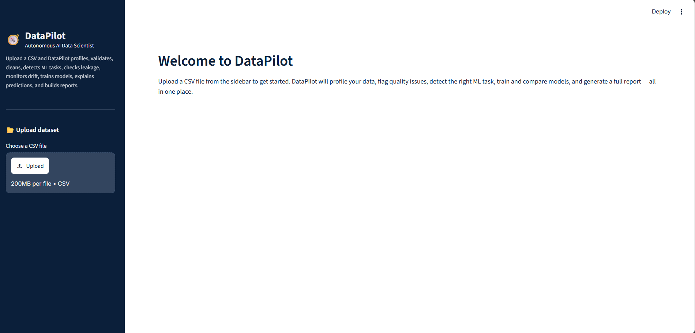
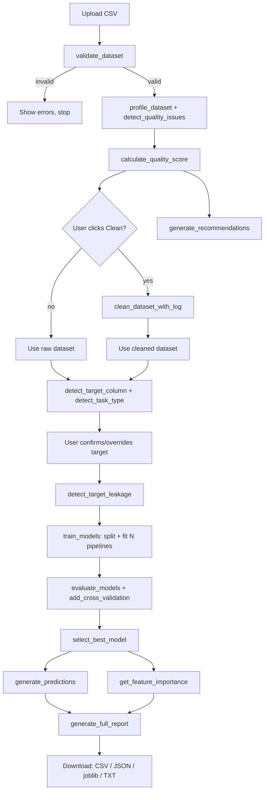
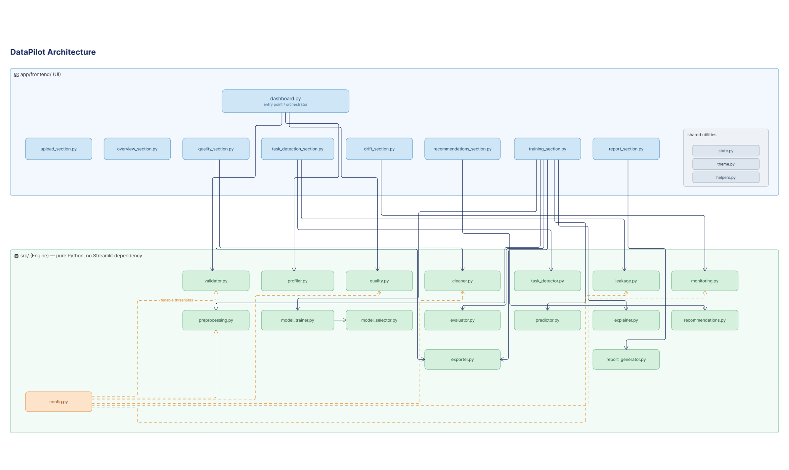

<h1 align="center">🧭 DataPilot</h1>

<p align="center"><b>Upload a CSV. Get it validated, cleaned, modeled, explained, and reported — with proof of exactly what was done to your data and why.</b></p>

<p align="center">
  <a href="https://www.python.org/"></a>
  <a href="https://streamlit.io/"></a>
  <a href="https://scikit-learn.org/"></a>
  <a href="https://pandas.pydata.org/"></a>
  <a href="https://numpy.org/"></a>
  <a href="https://docs.pytest.org/"></a>
  <a href="https://www.docker.com/"></a>
  <a href="LICENSE"></a>
</p>

<p align="center">
  🔗 <a href="https://dashboardpy-4v5mjwgedpkucub6sgi4af.streamlit.app/"><b>Live Demo</b></a>
  <br>
  Deployed on <a href="https://streamlit.io/cloud">Streamlit Community Cloud</a>
</p>

> 💡 **New here?** Jump to the [Beginner Usage Guide](#-beginner-usage-guide) — it walks through the app screen-by-screen, no prior ML or coding knowledge assumed.

**At a glance:**

| ✅ Strengths | ⚠️ Trade-offs |
|---|---|
| 56 passing tests, including real end-to-end checks (subprocess + `AppTest`) | Target/task detection is a heuristic, not a learned model |
| Zero Streamlit imports in `src/` — fully unit-testable engine | Drift monitoring compares numeric means only, no formal statistical test |
| Every threshold centralized in one config file, not scattered magic numbers | One-hot encoding caps at 30 categories — not ideal for high-cardinality features you want to keep |
| Documented, self-caught bug history with real root causes | No persistence across sessions, no auth, single-user by design |
| Auto-fixes safe issues, always asks before anything requiring judgment | `joblib` model files are Python/scikit-learn version-sensitive |



---

## 📑 Table of Contents

- [What is DataPilot?](#-what-is-datapilot)
- [Problem Statement](#-problem-statement)
- [Solution](#-solution)
- [Features](#-features)
- [Complete Workflow](#-complete-workflow)
- [Architecture](#️-architecture)
- [Project Structure](#-project-structure)
- [Module-by-Module Guide](#-module-by-module-guide)
- [Technology Stack](#️-technology-stack)
- [Requirements](#️-requirements)
- [Installation](#-installation)
- [Running the App](#️-running-the-app)
- [Beginner Usage Guide](#-beginner-usage-guide)
- [Input & Output](#-input--output)
- [Algorithms, Heuristics & Formulas](#-algorithms-heuristics--formulas)
- [Testing](#-testing)
- [Real Bugs Found & Fixed](#-real-bugs-found--fixed)
- [Engineering Decisions](#-engineering-decisions)
- [Hardcoding & Generalization](#-hardcoding--generalization)
- [Technical Deep Dive](#-technical-deep-dive)
- [Edge Cases](#-edge-cases)
- [Known Limitations](#️-known-limitations)
- [Roadmap](#-roadmap)
- [Scalability](#-scalability)
- [Docker & Deployment](#-docker--deployment)
- [Security & Privacy](#-security--privacy)
- [Performance](#-performance)
- [External Resources](#-external-resources)
- [Contributing](#-contributing)
- [License](#-license)
- [Author](#-author)
- [Acknowledgements](#-acknowledgements)

---

## 📖 What is DataPilot?

**In one sentence:** DataPilot is a web app — upload a spreadsheet (CSV), and it automatically checks the data for problems, fixes what's safely fixable, figures out what you're probably trying to predict, trains and compares a few machine-learning models, explains what they learned, and hands you a downloadable report — without you writing a line of code.

**For a complete beginner:** Imagine you have a spreadsheet of customer data and you want to predict who's going to cancel their subscription. Normally that means: writing code to clean messy data, writing more code to pick and train a model, writing more code to check if it actually worked — hours of repetitive setup before you learn anything interesting. DataPilot does that first pass for you. Upload the file, click through a handful of tabs, get a trained model and a plain-English explanation of what it found.

**Technically:** DataPilot is a [Streamlit](https://streamlit.io/) application with a strict separation between UI (`app/frontend/`) and logic (`src/`). Every actual data-science decision — profiling, cleaning, target/task detection, leakage screening, model training, evaluation, explainability, drift monitoring — is a plain Python function that takes a `pandas.DataFrame` in and returns a dict/list/DataFrame out. None of it imports Streamlit or knows a UI exists, which is what makes the 56-test suite possible without a browser.

**Who it's for:** anyone doing first-pass EDA/ML on a CSV who doesn't want to hand-write the same boilerplate pipeline every time — and, as a portfolio project, evidence of a tested, multi-module system rather than a single notebook.

---

## 🎯 Problem Statement

**Beginner version:** Every new CSV file starts the same tedious way — is anything missing? are there duplicates? do any numbers look wrong? what am I even trying to predict? which model is best? That checklist gets redone by hand, every single time.

**Technical version:** The first-pass stages of a tabular ML workflow — schema validation, EDA, cleaning, target/task inference, leakage screening, baseline model comparison, and reporting — are largely mechanical and repeat almost identically across datasets, yet are usually re-implemented ad hoc in a notebook each time. DataPilot codifies that repeatable part as a tested, reusable pipeline, while explicitly leaving genuine judgment calls (is this outlier real data or an error? is this the right target column?) to the human — surfaced as an overridable decision, never a silent guess.

---

## 💡 Solution

```text
Raw CSV
   ↓
Validation          (is this dataset usable at all?)
   ↓
Profiling + Quality scoring   (what does it look like, what's wrong?)
   ↓
Automated cleaning   (fix what has one safe, defensible answer — optional, one click)
   ↓
Target/task detection   (what should we predict, and how — classification or regression?)
   ↓
Leakage check        (would any feature "cheat"?)
   ↓
Train & compare multiple models   (with cross-validation where the data supports it)
   ↓
Explain the winner    (feature importance)
   ↓
Predict + Monitor drift + Recommend next steps
   ↓
Downloadable report, cleaned CSV, audit log, trained model
```

The guiding rule, visible throughout the codebase: **auto-fix things with one universally safe answer** (a missing number → median; extra whitespace in a category → trimmed), and **surface, warn, but never silently guess** things that require judgment (is this outlier real or bad data? is this class imbalance a problem? does this column contain personal data?).

---

## ✨ Features

### ✅ Implemented

| Feature | What it does |
|---|---|
| **Validation** | Structural checks before anything else runs — empty dataset, zero columns, duplicate column names, columns ≥50% missing. `src/validator.py` |
| **Profiling** | Per-column dtype, missing count/%, unique-value count, constant-column flag; dataset-level totals. `src/profiler.py` |
| **Quality scoring (0–100)** | **9 independent issue detectors** (see [Algorithms](#-algorithms-heuristics--formulas)), weighted by *what proportion of rows is actually affected*, not a flat penalty per issue found. `src/quality.py` |
| **Automated cleaning** | One click fixes what quality scoring found — duplicate removal, median/mode imputation, categorical whitespace + case normalization, IQR outlier correction with an identifier-column guard — and logs every single change (category, column, action, count, plain-English reason). `src/cleaner.py` |
| **ML task detection** | A multi-signal scoring heuristic guesses the likely target column and whether the task is Classification or Regression — always shown in an editable dropdown, never trained on silently. `src/task_detector.py` |
| **Class imbalance detection + mitigation** | Flags a minority class under 10% of rows (harder flag under 2 examples), **and** applies `class_weight="balanced"` to every classifier so the warning actually changes training behavior, not just displays a message. `src/task_detector.py`, `src/model_selector.py` |
| **Target leakage detection** | Flags suspiciously-named features, exact copies of the target, and correlation ≥0.98 — protected against `inf`/extreme-magnitude values and zero-variance columns corrupting the correlation math. `src/leakage.py` |
| **Model training & comparison** | Logistic Regression / Decision Tree / Random Forest (classification) or Linear Regression / Decision Tree / Random Forest (regression), each inside a full `ColumnTransformer` + `Pipeline` (median/mode imputation, `StandardScaler`, `OneHotEncoder`). `src/model_selector.py`, `src/model_trainer.py`, `src/preprocessing.py` |
| **Cross-validation** | 5-fold CV, automatically **skipped** (not attempted-then-suppressed) when a class has too few samples to fold reliably. `src/evaluator.py` |
| **Explainability** | Feature importance via `.feature_importances_` (tree models) or `.coef_` (linear models), mapped back to human-readable feature names post-encoding. `src/explainer.py` |
| **Batch predictions** | Runs the trained pipeline over a dataset and appends a `prediction` column. `src/predictor.py` |
| **Drift monitoring** | Compares a current dataset against a reference dataset for schema changes and numeric mean drift. `src/monitoring.py` |
| **Recommendations engine** | Plain-English, prioritized (High/Medium/Low) action items synthesized from quality score, drift warnings, and class imbalance. `src/recommendations.py` |
| **PII pattern detection** | Regex-based (not column-name-based) detection of likely email/phone-number columns — informational only, nothing is auto-removed. `src/quality.py` |
| **Exports** | Cleaned dataset (CSV), audit log (JSON), predictions (CSV), trained model (`.joblib`), and one combined text report. `src/exporter.py`, `src/report_generator.py` |

### ⚠️ Partial / Limited

| Feature | Limitation |
|---|---|
| **Drift monitoring** | Compares numeric **means** only — no standard deviation, no categorical distribution comparison, no formal statistical test (KS-test, PSI). A reasonable first signal, not full distribution-drift detection. |
| **Target/task detection** | A keyword-and-statistics heuristic, not a learned model — works well on conventionally-named columns, can misfire on unusual schemas. This is exactly why the target dropdown is editable, not automatic. |
| **Outlier correction** | IQR + median replacement is a reasonable general default, not appropriate for every distribution (e.g. genuinely multi-modal data). |

### 🔮 Planned (not implemented — see [Roadmap](#-roadmap))

- Hyperparameter tuning (`optuna`)
- Real SHAP-based explainability (currently coefficient/impurity-based)
- `xgboost` as a fourth candidate model
- Multi-sheet `.xlsx` export (`openpyxl`)

---

## 🔄 Complete Workflow



Every tab's underlying code executes on **every** Streamlit rerun — `st.tabs()` only changes what's *visible*, not what runs. This was a deliberate choice (see [Engineering Decisions](#-engineering-decisions)).

---

## 🏗️ Architecture



- **Nothing in `src/` imports Streamlit.** Every function is unit-testable with a two-line script — no browser session required.
- **`src/config.py` is the single source of every tunable threshold** (IQR multiplier, identifier-ratio cutoff, leakage correlation cutoff, drift %, one-hot cardinality cap, ...). Its own header comment documents *why*: these numbers used to be hardcoded independently across five files and could silently drift out of sync when only one got tuned.
- **No database, no external API, no backend beyond Streamlit's own** — a single-process app; all "storage" is either in-memory (`st.session_state`) for the session, or a browser download.

---

## 📁 Project Structure

```text
DataPilot/
├── .github/workflows/
│   └── ci.yml                      # GitHub Actions: pytest (3.11 & 3.12) + Docker build check
├── .streamlit/
│   └── config.toml                 # Base Streamlit theme colors
├── app/
│   └── frontend/
│       ├── dashboard.py            # Thin entry point — wires session state, renders tabs
│       ├── state.py                # Session-state defaults
│       ├── theme.py                # CSS injection (navy/amber "flight deck" theme)
│       ├── helpers.py              # Shared display/formatting helpers
│       └── sections/               # One render_*(ctx) function per tab
│           ├── upload_section.py
│           ├── overview_section.py
│           ├── quality_section.py
│           ├── task_detection_section.py
│           ├── drift_section.py
│           ├── recommendations_section.py
│           ├── training_section.py
│           └── report_section.py
├── src/                            # Business logic — zero Streamlit imports
│   ├── config.py
│   ├── validator.py
│   ├── profiler.py
│   ├── quality.py
│   ├── cleaner.py
│   ├── task_detector.py
│   ├── leakage.py
│   ├── preprocessing.py
│   ├── model_selector.py
│   ├── model_trainer.py
│   ├── evaluator.py
│   ├── predictor.py
│   ├── explainer.py
│   ├── monitoring.py
│   ├── recommendations.py
│   ├── report_generator.py
│   └── exporter.py
├── tests/                          # pytest suite — 56 tests across 17 files
│   ├── conftest.py
│   ├── test_dashboard_entrypoint.py
│   ├── test_section_rename_regression.py
│   └── test_*.py
├── data/
│   ├── raw/                        # Demo-ready sample CSVs
│   ├── processed/                  # Empty scratch space (gitignored contents)
│   └── edge_cases/                 # 16-file robustness/QA pack — not demo material
├── models/                         # Empty scratch space for saved .joblib models
├── experiments/                    # Empty scratch space, unwired to the app
├── Dockerfile
├── .dockerignore
├── pytest.ini
├── requirements.txt                # Actual runtime dependencies
├── requirements-optional.txt       # Honest roadmap — packages NOT currently used
├── CHANGELOG.md
├── LICENSE                         # MIT
└── README.md
```

> 📝 Nearly every folder above has its own local `README.md` explaining specifically why that folder exists — worth a look if exploring the repo folder-by-folder.

---

## 🧩 Module-by-Module Guide

<details>
<summary><strong>src/validator.py</strong> — first checkpoint after upload</summary>

`validate_dataset(df)` → `{"valid", "errors", "warnings"}`. Hard errors: not a DataFrame, empty dataset, zero columns, duplicate column names. Soft warnings: fully empty columns, columns ≥50% missing. Explicitly guards a real pandas gotcha: a duplicate column name makes `df[column]` return a DataFrame instead of a Series, which would crash a naive `.isna().all()` check.
</details>

<details>
<summary><strong>src/profiler.py</strong> — dataset overview numbers</summary>

`profile_dataset(df)` → row/column counts, duplicate-row count, total missing values, and per-column dtype/missing%/unique-count/constant-flag. Purely descriptive, no judgment calls.
</details>

<details>
<summary><strong>src/quality.py</strong> — 9 issue detectors + scoring</summary>

`detect_quality_issues(df)` checks: Missing Values, Duplicate Rows, Constant Columns, Category Inconsistency, Potential Outliers (IQR), Invalid Values (numeric-as-text — reuses `cleaner.py`'s own detection function so the two can never disagree), Heavily Missing Column (≥50%), Possible Personal Information (regex-matched), Non-Finite Values (`inf`/`-inf`, called out separately from ordinary outliers since they break correlation/scaling math outright).

`calculate_quality_score(df, issues)` → 0–100, weighting each issue by *what fraction of rows it affects*, not a flat penalty — see the exact weight table in [Algorithms](#-algorithms-heuristics--formulas).
</details>

<details>
<summary><strong>src/cleaner.py</strong> — the one cleaning engine, full audit log</summary>

`clean_dataset_with_log(df)` runs, in this order: (1) remove exact duplicate rows, (2) fill missing values (numeric → median, categorical → mode), (3) normalize categorical text (whitespace + case), (4) correct numeric anomalies/outliers, (5) remove constant columns — run **last**, deliberately, since step 4 can turn a near-constant column fully constant.

This is the *only* cleaning code path in the project — the dashboard has no separate copy. Identifier-like columns (name ending in `id`/`uuid`/etc., or ≥98% unique on datasets ≥30 rows) are protected from having their values replaced; a hardcoded measurement-name safety list (`age`, `income`, `price`, ...) can never be overridden by the ratio check alone — see the real bug this fixes, below.
</details>

<details>
<summary><strong>src/task_detector.py</strong> — target/task inference + class balance</summary>

`detect_target_column(df)` scores every column additively: +100 for an exact strong-target-name match, +35 per target-like keyword, an ID-keyword penalty, a uniqueness-ratio penalty (very-unique columns are unlikely targets), a feature-keyword penalty (`age`, `salary`, ... look like inputs), a small cardinality bonus for binary/low-cardinality columns, a missing-value penalty, and a slight tie-break preference for the last column. Returns `None` if every column scores non-positive.

`detect_task_type(df, target_column)` classifies Classification vs. Regression from dtype/cardinality. `check_class_imbalance(target)` flags a minority class under 10% (or under 2 samples). `resolve_target_selectbox_options()` is a deliberately pure, Streamlit-free function deciding what the target dropdown shows — see the real bug it fixes, below.
</details>

<details>
<summary><strong>src/leakage.py</strong> — target leakage screening</summary>

`detect_target_leakage(df, target_column)` runs three checks: suspicious feature names (`future`, `predicted`, `outcome`, ...), exact-copy columns, and correlation ≥0.98. Values with magnitude ≥`1e100` are excluded before the correlation math runs (squaring such a value would overflow float64), and the correlation is skipped entirely when either side has fewer than 2 distinct values (mathematically undefined otherwise) — both real numerical-stability fixes, not cosmetic ones.
</details>

<details>
<summary><strong>src/preprocessing.py</strong> — feature-side prep</summary>

`build_preprocessor(df, target_column)` builds a scikit-learn `ColumnTransformer`: numeric columns get median imputation + `StandardScaler`; categorical columns get most-frequent imputation + `OneHotEncoder(handle_unknown="ignore", max_categories=30)`. Categorical columns >90% unique are dropped entirely before encoding. `detect_high_cardinality_columns()` exposes the same check standalone so the dashboard can show the user what's about to be excluded, and why, before training starts.
</details>

<details>
<summary><strong>src/model_selector.py</strong> + <strong>model_trainer.py</strong> — candidates + training</summary>

Classification: `LogisticRegression(max_iter=1000, class_weight="balanced")`, `DecisionTreeClassifier(random_state=42, class_weight="balanced")`, `RandomForestClassifier(n_estimators=100, random_state=42, class_weight="balanced")`. Regression: `LinearRegression()`, `DecisionTreeRegressor(random_state=42)`, `RandomForestRegressor(n_estimators=100, random_state=42)`.

`train_models()` requires ≥10 rows, attempts a stratified 80/20 split for classification (falling back to a plain split if any class has fewer than 2 examples), and fits a fresh `Pipeline(preprocessor, model)` per candidate.
</details>

<details>
<summary><strong>src/evaluator.py</strong> — metrics, CV, best-model selection</summary>

`evaluate_models()`: accuracy/precision/recall/F1 (weighted, `zero_division=0`) for classification; MAE/RMSE/R² for regression. `add_cross_validation()` adds 5-fold CV (F1-weighted or R²), skipped cleanly (not attempted-and-caught) when a class has too few samples to fold reliably. `select_best_model()` prefers CV score when present, otherwise the hold-out F1/R².
</details>

<details>
<summary><strong>src/predictor.py</strong> + <strong>src/explainer.py</strong></summary>

`generate_predictions()` runs the fitted pipeline over a DataFrame and appends a `prediction` column. `get_feature_importance()` extracts `feature_importances_` (tree models) or `abs(coef_)` (linear models), mapped to real post-encoding feature names; returns an empty DataFrame for unsupported model types rather than raising.
</details>

<details>
<summary><strong>src/monitoring.py</strong> — drift detection</summary>

`compare_datasets()` reports added/removed columns and, per shared numeric column, the % change in mean. `detect_data_drift()` turns a ≥20% mean shift into a warning, plus separate warnings for any schema change.
</details>

<details>
<summary><strong>src/recommendations.py</strong> + <strong>report_generator.py</strong> + <strong>exporter.py</strong></summary>

`generate_recommendations()` turns quality score, issue severities, drift warnings, and class balance into prioritized action items. `generate_full_report()` assembles everything run so far into one text report — sections that weren't run are simply omitted, not shown as blank/broken. `exporter.py` is pure serialization: DataFrame → CSV/JSON bytes, model → joblib bytes.
</details>

---

## 🛠️ Technology Stack

| Technology | Where / Why it's used |
|---|---|
| [Python](https://www.python.org/) 3.11 / 3.12 | Core language — CI tests both; the Dockerfile pins `python:3.12-slim`. |
| [Streamlit](https://streamlit.io/) | The entire UI — file upload, tabs, widgets, session state. Zero business logic lives here. |
| [pandas](https://pandas.pydata.org/) | All DataFrame manipulation — profiling, cleaning, quality checks, monitoring. |
| [NumPy](https://numpy.org/) | Numeric-stability checks (`np.isfinite`, `np.isclose`) in `cleaner.py`, `quality.py`, `leakage.py`. |
| [scikit-learn](https://scikit-learn.org/) | `ColumnTransformer`/`Pipeline` preprocessing, all six candidate models, train/test split, cross-validation, every evaluation metric. |
| [joblib](https://joblib.readthedocs.io/) | Serializing/deserializing trained pipelines for download. |
| [pytest](https://docs.pytest.org/) | The full 56-test suite, including a Streamlit `AppTest`-based end-to-end test. |
| [Docker](https://www.docker.com/) | Optional containerized deployment. |
| [GitHub Actions](https://docs.github.com/actions) | CI — test matrix (3.11 & 3.12) + Docker build verification. |

**Not used** (worth being explicit about — see `requirements-optional.txt`): XGBoost, LightGBM, CatBoost, SHAP, Optuna, any database, any external API, any authentication system.

---

## ⚙️ Requirements

- Python 3.11 or 3.12
- `pip`
- No API keys, no external services, no database — everything runs locally
- No GPU required — every model is a lightweight scikit-learn estimator

---

## 📦 Installation

```bash
# 1. Clone the repository
git clone https://github.com/Subham093/DataPilot.git
cd DataPilot

# 2. Create a virtual environment
python -m venv venv

# 3. Activate it
# Windows (PowerShell):
venv\Scripts\Activate.ps1
# macOS/Linux:
source venv/bin/activate

# 4. Install dependencies
pip install -r requirements.txt
```

No environment variables or additional configuration are required.

---

## ▶️ Running the App

```bash
streamlit run app/frontend/dashboard.py
```

Streamlit prints a local URL — typically:

```
http://localhost:8501
```

### With Docker instead

```bash
docker build -t datapilot .
docker run -p 8501:8501 datapilot
```

Then open `http://localhost:8501`.

---

## 👶 Beginner Usage Guide

1. **Upload** — sidebar → "Choose a CSV file" → pick a file → **🚀 Upload & Analyze**.
2. **📊 Overview** — see row/column counts and a data preview.
3. **🩺 Data Quality** — see the 0–100 score and what's wrong (if anything). Click **Clean Dataset Automatically** if you want DataPilot to fix what it safely can — review the audit log of exactly what changed.
4. **🤖 Task Detection** — confirm (or change) which column you're trying to predict, and the detected task type.
5. **📈 Monitoring** *(optional)* — upload a second CSV to compare against for drift.
6. **💡 Recommendations** — read the prioritized suggestions.
7. **🚀 Model Training** — click **Train & Compare Models**, review the metrics table, generate predictions.
8. **📄 Report** — download the full report, cleaned CSV, audit log, predictions, and/or trained model.

New to trying it? Any file in `data/raw/` is safe, demo-ready sample data — each one is built to showcase a specific feature (see that folder's own `README.md`).

---

## 📥 Input & Output

### Input
- **Format:** CSV only (`st.file_uploader(type=["csv"])`)
- **Size limit:** Streamlit's default 200MB per file
- **Structure:** no fixed schema or column-name requirement — validated first, with clear errors on anything fundamentally unusable (empty, duplicate column names)
- **Column types:** numeric and text/categorical both supported; numeric-looking text (e.g. `"42"` stored as a string) is auto-detected where ≥80% of a column's values parse successfully
- **Minimum rows for training:** 10 (enforced by `train_models()`, which raises rather than attempting a meaningless split)

### Output

| Output | Format | Where |
|---|---|---|
| Cleaned dataset | `.csv` | Data Quality tab |
| Cleaning audit log | `.json` | Data Quality tab |
| Predictions | `.csv` | Model Training tab |
| Trained model | `.joblib` | Model Training tab |
| Full report | `.txt` | Report tab |

All downloads are generated in-memory and streamed to the browser — nothing is written to disk on the server during normal use.

---

## 🧮 Algorithms, Heuristics & Formulas

### Quality score (`src/quality.py`)

Starts at 100, reduced by a per-issue penalty:

| Category | Weight | Trigger |
|---|---|---|
| Missing Values | `min(count/rows, 1.0) × 15` | Any missing value |
| Invalid Values | `min(count/rows, 1.0) × 15` | Non-numeric text inside a predominantly numeric column |
| Duplicate Rows | `min(count/rows, 1.0) × 10` | Exact duplicate rows |
| Heavily Missing Column | flat `10` | ≥50% of a column is missing |
| Non-Finite Values | flat `12` | Literal `inf`/`-inf` present |
| Constant Column | flat `5` | Only one unique value |
| Possible Personal Information | flat `3` | Email/phone-shaped values, regex-matched |
| Category Inconsistency | flat `3` | Case/whitespace variants of the same category |
| Potential Outliers | flat `2` | IQR-flagged values |

Weights reflect actual risk, not issue count: a heavily-missing column (10) is penalized more than an ordinary missing value, since imputing 70%+ fabricated data is a bigger integrity concern than filling a handful of gaps. Score is clamped to `[0, 100]`.

### Outlier detection — IQR (Tukey's fences)

```
IQR = Q3 − Q1
lower_bound = Q1 − 1.5 × IQR
upper_bound = Q3 + 1.5 × IQR
```

Skipped on columns with fewer than 8 valid values (bounds too noisy to trust). If more than 20% of a column's values would be flagged, DataPilot treats that as real variation, not bad data, and flags it for manual review instead of auto-correcting.

### Identifier column protection

A column is protected from having its values replaced if:
1. Its name ends in `id`, `_id`, `identifier`, `serial`, or `uuid`, **or**
2. It's ≥98% unique **and** the dataset has ≥30 rows **and** the column name isn't a known measurement term (`age`, `income`, `price`, ...)

The 30-row and known-measurement-name conditions exist because of a real bug — see [Real Bugs Found & Fixed](#-real-bugs-found--fixed).

### Target-column scoring

An additive/subtractive point system: `+100` for an exact strong-name match (`target`, `label`, `y`, ...), `+35` per target-like keyword match, penalties for ID-like names and high uniqueness, penalties for feature-like names (`age`, `salary`, ...), a small bonus for binary/low-cardinality columns, a missing-value penalty, and a slight tie-break toward the last column. Transparent and inspectable — not a trained model.

### Class imbalance detection

```
minority_ratio = minority_class_count / total_rows
is_imbalanced = minority_ratio < 0.10
too_few_to_split = minority_class_count < 2
```

### Target leakage detection

Three independent checks: suspicious feature *names*, exact-copy columns, and Pearson correlation ≥0.98 — after excluding `NaN`, non-finite, and magnitude-≥1e100 values, and skipping the calculation entirely when either side has fewer than 2 distinct values.

### Drift detection

Compares the numeric **mean** of each shared column between a reference and current dataset; flags a warning if the % change exceeds 20%. Also flags any column present in one dataset but not the other.

---

## 🧪 Testing

```bash
pytest
```

**56 tests across 17 files** in `tests/` — mostly one file per `src/` module (coverage isn't strictly 1:1; see `tests/README.md`). Notable ones:

- **`test_dashboard_entrypoint.py`** — runs `python app/frontend/dashboard.py` as a real subprocess and inspects stderr for `ModuleNotFoundError`, since `streamlit run` and `pytest` resolve import paths differently and a bug here wouldn't be caught by ordinary unit tests.
- **`test_section_rename_regression.py`** — boots the real dashboard via Streamlit's own `AppTest` framework as an end-to-end check, not just isolated function calls.
- **`test_target_selectbox.py`** — covers the "no confident target detected" UI-state logic in isolation.
- **`conftest.py`** — a shared "messy" fixture DataFrame (duplicates, missing values, case-inconsistent categories) reused across cleaning-related tests.

CI (`.github/workflows/ci.yml`) runs this suite on Python 3.11 **and** 3.12 on every push/PR to `main`, then separately verifies the Docker image builds.

---

## 🐛 Real Bugs Found & Fixed

Documented from `CHANGELOG.md` and inline code comments — not reconstructed or invented.

| Problem | Why it happened | Fix | Lesson |
|---|---|---|---|
| `streamlit run app/frontend/dashboard.py` could fail with `ModuleNotFoundError: No module named 'src'` | `streamlit run` only adds the target file's own folder to `sys.path`, not the project root — unlike `pytest`, which resolves this automatically via `pytest.ini` | `dashboard.py` now explicitly computes and inserts the project root into `sys.path` before any `src` import | A test suite passing doesn't guarantee the real entry point works — added `test_dashboard_entrypoint.py` to close exactly this gap |
| An 11-row dataset's `age` column had a real outlier (`200`, vs. a normal range of 24–51) silently skipped during cleaning | The identifier-detection ratio check (minimum row threshold was originally `10`) saw 11/11 unique values and classified `age` as an ID column, exempting it from correction | Raised the row-count threshold to 30, and added a second, independent safety net — a hardcoded set of known measurement-column names that can never be classified as an identifier by ratio alone | A statistical heuristic needs a minimum sample size to be meaningful, plus an orthogonal backup signal — not just a bigger threshold |
| Cleaning audit log claimed **"Filled with median"** on a column that was 100% missing | `pandas.median()` on an all-NaN column returns `NaN` itself; `fillna(NaN)` is a silent no-op, but the code logged success unconditionally | Skip the fill-log entry when the computed median is itself undefined; let the (already-correct) constant-column-removal step explain what actually happened | Log what *actually* happened, not what a step nominally attempted |
| Calling `.median()` on an all-NaN column could emit a spurious `RuntimeWarning: Mean of empty slice` on some pandas/NumPy version combinations, even though the returned value (`NaN`) is correct | `.median()` was called unconditionally, then the result was checked with `pd.isna()` afterward — the warning path could trigger before that check ever ran | Check `column.notna().sum() == 0` *before* calling `.median()` at all, skipping the call entirely for all-missing columns instead of calling it and inspecting the result | Guard against a risky operation before it runs, don't call it and hope the result-check catches the fallout — especially for behavior that can vary silently across dependency versions |
| Data Quality tab and the cleaning audit log disagreed on issue counts | `quality.py` and `cleaner.py` each had an independent implementation of "does this column look numeric," which could silently drift apart | `quality.py` now imports and reuses `cleaner.py`'s exact detection function instead of reimplementing it | Duplicated business logic across modules is a silent-inconsistency bug waiting to happen |
| `TypeError: cannot safely cast non-equivalent float64 to int64` when cleaning a column containing `1e308` | A value can be mathematically whole (passes a `% 1 == 0` check) while still being astronomically larger than `Int64` can represent | Added an explicit finite-and-in-range check before attempting the `Int64` cast, not just a whole-number check | "Is this a whole number" and "does this fit in the target type" are two separate questions |
| `RuntimeWarning: invalid value encountered in divide` during leakage correlation on constant or near-infinite columns | Pearson correlation divides by each column's standard deviation — undefined (0/0) for a constant column, overflow-prone for `inf`/extreme-magnitude values | Skip the correlation calculation entirely (not compute-then-discard) when either column has fewer than 2 distinct values or contains non-finite/extreme values | Prevent a mathematically undefined operation rather than computing it and suppressing the noisy-but-correct result |
| The target-column dropdown, on a dataset with no confident auto-detected target, silently defaulted to the *first* column | The dashboard's own fallback logic hardcoded `default_index = 0` whenever detection returned `None` | Extracted the decision into a pure, unit-tested function that shows an explicit placeholder ("— Select a target column —") instead of silently pre-selecting a real column | "No confident answer" should be a visible UI state, not silently collapsed into an arbitrary default |
| Class imbalance was detected and displayed, but never mitigated during training | `check_class_imbalance()` existed and warned the user, but nothing in `model_selector.py` changed how models were actually trained | Added `class_weight="balanced"` to all three classifiers — verified on a realistic imbalanced dataset: minority-class recall went from 0.00 to 0.33 with this one change, same data, same model | A warning without a mitigation is only half a feature |

Full dated history in [`CHANGELOG.md`](CHANGELOG.md).

---

## 🧠 Engineering Decisions

- **`src/` never imports Streamlit** — every business-logic function needs to be testable without a browser session; this is why the full suite runs in under 10 seconds.
- **`dashboard.py` was split into `state.py` / `theme.py` / `helpers.py` / `sections/*.py`** — it used to be a single ~1,900-line file. The split was done via AST-based variable analysis (not manual find/replace) specifically to guarantee zero behavioral change, verified against the full test suite and real end-to-end app sessions before and after.
- **`app/frontend/sections/*.py` are named `*_section.py`**, not just `quality.py` — to avoid colliding with the identically-named `src/quality.py`, `src/recommendations.py`, etc.
- **Every threshold lives in `src/config.py`** — before this file existed, the same numbers were hardcoded independently across five modules, a classic source of silent inconsistency.
- **`st.tabs()` instead of separate pages** — every tab's code still executes on every rerun regardless of which tab is visible, so cross-tab state (e.g. the target column picked in Task Detection, which Model Training depends on) keeps working exactly as it did in the original single-page script.
- **Auto-detection is always overridable, never silent** — both the target-column dropdown and the cleaning step are presented as defaults the user confirms, a direct response to the target-selectbox bug above.
- **Cleaning auto-fixes some issues but only *warns* about others** — one universally safe answer gets fixed automatically; anything requiring judgment (is this outlier real? is this imbalance a problem? does this look like PII?) is surfaced, never silently resolved.

---

## 🔐 Hardcoding & Generalization

DataPilot makes **no assumptions about column names, dataset domain, or schema** — target detection, task-type inference, cleaning, and leakage checks all operate on statistical/structural signals (dtype, cardinality, missing ratio, name-keyword matching), not specific expected columns. Verified by the 16-file `data/edge_cases/` pack, which deliberately varies schema, naming, and structure.

What **is** hardcoded, by design, and documented honestly:
- ⚠️ A small set of keyword lists (target-like words, ID-like words, feature-like words, leakage-suggestive words, known measurement-column names) — tuned on common English column-naming conventions; less effective on other languages or cryptic abbreviations.
- ⚠️ Numeric thresholds in `config.py` are fixed defaults, tunable in one place, not currently exposed as UI controls.
- ✅ Training requires ≥10 rows; below that, `train_models()` raises rather than attempting a meaningless split.
- ✅ No fixed file paths beyond the project's own structure — uploaded data is never written to a hardcoded location.

---

## 🔬 Technical Deep Dive

- **State management:** `st.session_state` for cross-rerun persistence (uploaded dataset, cleaning/training results); a per-run `SimpleNamespace` (`ctx`) for values that only need to flow between tabs within a single script execution.
- **Data flow between tabs:** since every tab's code runs on every rerun, a value computed in an earlier tab (e.g. `ctx.cleaned_df`) is simply an attribute on the shared `ctx` object, read by a later tab in the same script run.
- **Error handling:** sections wrap risky operations (e.g. task detection) in `try/except`, degrading to a clear warning rather than crashing the whole page.
- **File handling:** everything happens in-memory via pandas; downloads are generated as in-memory bytes and streamed directly to the browser — nothing touches server-side disk during normal use.
- **No caching layer, no background jobs, no async** — a synchronous, single-session app by design; there's no current need for more given the scope.

---

## 🧪 Edge Cases

`data/edge_cases/` is a 16-file robustness/QA pack, each file targeting one specific failure mode (see that folder's `README_TESTS.txt` for the full breakdown).

### ✅ Handled
- All-missing column → correctly dropped, no false "filled" claim in the audit log
- Extreme class imbalance (29:1, and a 1-example minority class) → detected, warned, CV skipped cleanly, `class_weight="balanced"` mitigates during training
- Target leakage (exact copies, near-perfect correlation) → detected and flagged
- `inf` / `-inf` / astronomically large finite values (`1e308`) → no longer crash cleaning; excluded from correlation math; flagged as a distinct "Non-Finite Values" issue
- Constant columns / single-class target → removed during cleaning, with an explicit warning connecting the dots in Task Detection
- High-cardinality identifier + PII columns (name, email) → excluded from training with a visible reason, separately flagged as possible personal information
- Numeric values stored as text, with genuinely non-numeric values mixed in → detected and imputed with median

### ⚠️ Partially handled
- A dataset with no clearly-named target column → the heuristic still picks *something* (the least-bad candidate); the editable target dropdown is the actual safety net, not the detector refusing to guess

### ❌ Not currently handled
- Non-English column names/keywords (target/leakage detection relies on English keyword lists)
- Time-series-aware splitting (train/test split is random, not chronological)
- Full distribution drift (only mean-based drift is checked)

---

## ⚠️ Known Limitations

- **Target/task auto-detection is a heuristic, not a learned model.** Works well on conventionally-named columns, can misfire on unusual schemas — always confirm the detected target in the editable dropdown before training.
- **Outlier correction (IQR + median replacement)** is a reasonable general default, not appropriate for every distribution — review the audit log rather than treating cleaned data as ground truth.
- **Model persistence via `joblib`** is Python- and scikit-learn-version sensitive; a model exported in one environment may not load cleanly in another.
- **Drift monitoring compares numeric means only** — no standard deviation, no categorical drift, no formal statistical test. A reasonable MVP signal, not full distribution-drift detection.
- **One-hot encoding caps out at 30 categories** and drops columns above 90% uniqueness — appropriate for typical tabular data, not for high-cardinality categorical features you actually want to keep.
- **No time-series awareness anywhere** — train/test split is random (stratified for classification where possible), not chronological.
- **Single-session, single-process app** — no persistent storage, user accounts, or history across sessions.
- **No authentication** — anyone with access to a running instance can upload and process data.

---

## 🔮 Roadmap

### Immediate
- Wire in `optuna` for real hyperparameter tuning (highest interview value per the project's own roadmap notes — shows reasoning about search spaces, not just calling `.fit()`)
- Extend drift monitoring beyond mean comparison (standard deviation, a real statistical test like KS-test or PSI)

### Medium-term
- Replace/augment coefficient-based feature importance with real SHAP values (`shap`)
- Add `xgboost` as a fourth candidate model
- Multi-sheet `.xlsx` export via `openpyxl`

### Long-term
- Support for larger-than-memory datasets (currently everything is a full in-memory pandas DataFrame)
- Optional persistence layer so results survive across sessions

*(Sourced directly from `requirements-optional.txt`'s own prioritized comments and `CHANGELOG.md` — not invented for this README.)*

---

## 📈 Scalability

**Current architecture:** single-process, in-memory, one dataset at a time — sized for typical CSV files (thousands to low hundreds-of-thousands of rows) that comfortably fit in memory alongside pandas' overhead.

**If this needed to scale further:** the clean `src`/`app` separation means the core logic could be extracted behind an API (FastAPI/Flask) with a separate frontend, or adapted to a chunked/streaming model (e.g. via Dask) without touching the UI layer — a realistic direction, not a current capability.

---

## 🐳 Docker & Deployment

A `Dockerfile` exists, documented in its own header comments as optional: Streamlit Community Cloud deploys straight from `requirements.txt` with no Docker involved, but the Dockerfile matters the moment you want to deploy anywhere else (Render, Railway, a VM), where "works on my machine" would otherwise be a real risk.

```bash
docker build -t datapilot .
docker run -p 8501:8501 datapilot
```

- Base image: `python:3.12-slim`
- Installs only `requirements.txt` (not the optional/unused dependencies)
- Includes a `HEALTHCHECK` against Streamlit's own `/_stcore/health` endpoint, so hosting platforms can detect real readiness, not just process start
- Entrypoint: `streamlit run app/frontend/dashboard.py --server.port=8501 --server.address=0.0.0.0 --server.headless=true`

**CI/CD:** GitHub Actions runs the full suite on Python 3.11 and 3.12 on every push/PR to `main`, then separately verifies the Docker image builds — no automatic deployment step exists yet (CI, not CD).

<!--
🏗️ DIAGRAM PLACEHOLDER
Type: Deployment diagram
Show: Browser → Docker container (Streamlit on :8501) → local filesystem only
Purpose: Makes explicit there are no external services (databases, APIs) to
         deploy alongside the app.
-->

---

## 🔒 Security & Privacy

- **No secrets, API keys, or credentials anywhere in the codebase.**
- **No external network calls are made with uploaded data** — all processing is local to the running instance.
- **Uploaded data is never written to disk automatically** — it lives in memory for the session and is discarded when the session ends.
- **PII detection is informational only** — DataPilot flags likely email/phone columns so the user can decide what to do; nothing is auto-removed, masked, or transmitted.
- **`joblib` model files are pickle-based** — loading a `.joblib` file from an untrusted source can execute arbitrary code, a standard risk of Python's pickle serialization in general, not specific to DataPilot, but worth knowing before loading a model you didn't produce yourself.
- **No authentication layer** — treat any publicly-hosted instance accordingly.

---

## ⚡ Performance

No formal benchmarks have been run or are claimed here. Practically: every model used is a lightweight scikit-learn estimator, so training is fast (seconds, not minutes) at the dataset sizes this tool targets. The main real constraint is memory — everything is a full in-memory pandas DataFrame, so very large files would hit RAM limits before any modeling bottleneck.

---

## 🔗 External Resources

- [Streamlit Documentation](https://docs.streamlit.io/)
- [pandas Documentation](https://pandas.pydata.org/docs/)
- [scikit-learn Documentation](https://scikit-learn.org/stable/)
- [scikit-learn: Column Transformer with Mixed Types](https://scikit-learn.org/stable/auto_examples/compose/plot_column_transformer_mixed_types.html) — the exact pattern `preprocessing.py` implements
- [scikit-learn: `class_weight` parameter](https://scikit-learn.org/stable/modules/generated/sklearn.linear_model.LogisticRegression.html)
- [scikit-learn: Cross-validation](https://scikit-learn.org/stable/modules/cross_validation.html)
- [NumPy Documentation](https://numpy.org/doc/stable/)
- [joblib Documentation](https://joblib.readthedocs.io/)
- [pytest Documentation](https://docs.pytest.org/)
- [Streamlit: AppTest (testing Streamlit apps)](https://docs.streamlit.io/develop/api-reference/app-testing)
- [Tukey's fences (IQR outlier rule)](https://en.wikipedia.org/wiki/Outlier#Tukey's_fences)
- [Docker Documentation](https://docs.docker.com/)
- [GitHub Actions Documentation](https://docs.github.com/actions)
- [Keep a Changelog](https://keepachangelog.com/en/1.1.0/) — the format `CHANGELOG.md` follows

Repository-internal docs: [`CHANGELOG.md`](CHANGELOG.md) · [`src/README.md`](src/README.md) · [`tests/README.md`](tests/README.md) · [`data/edge_cases/README.md`](data/edge_cases/README.md) · [`LICENSE`](LICENSE)

---

## 🤝 Contributing

No `CONTRIBUTING.md` currently exists. Suggested workflow for anyone picking this project up:

1. Fork and clone the repo
2. `pip install -r requirements.txt`
3. Make changes, keeping business logic in `src/` free of Streamlit imports
4. Add/update tests in `tests/` — `pytest` should stay green
5. Open a pull request; CI must pass before merging

---

## 📜 License

MIT — see [`LICENSE`](LICENSE).

---

## 👤 Author

**Subham Maheswari Jena**

- GitHub: [Subham093](https://github.com/Subham093)

---

## 🙏 Acknowledgements

This project was built with the help of the following open-source technologies and libraries:

- [Streamlit](https://streamlit.io/) — the entire interactive web UI
- [pandas](https://pandas.pydata.org/) — DataFrame manipulation across the whole pipeline
- [scikit-learn](https://scikit-learn.org/) — preprocessing pipelines, models, and evaluation metrics
- [NumPy](https://numpy.org/) — numeric-stability checks underpinning cleaning and leakage detection
- [joblib](https://joblib.readthedocs.io/) — trained-model serialization
- [pytest](https://docs.pytest.org/) — the full automated test suite
- [Docker](https://www.docker.com/) — containerized, portable deployment
- [GitHub Actions](https://docs.github.com/actions) — continuous integration

A huge thanks to the open-source community and the maintainers behind these projects.